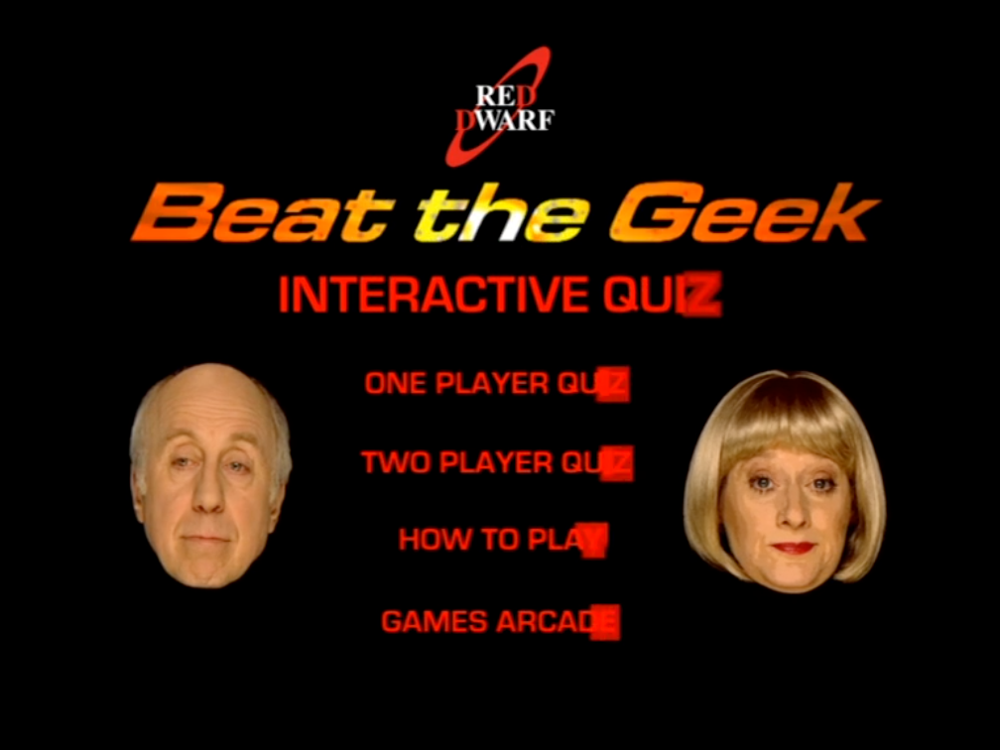
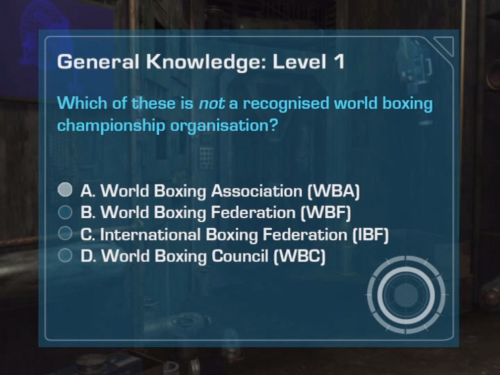
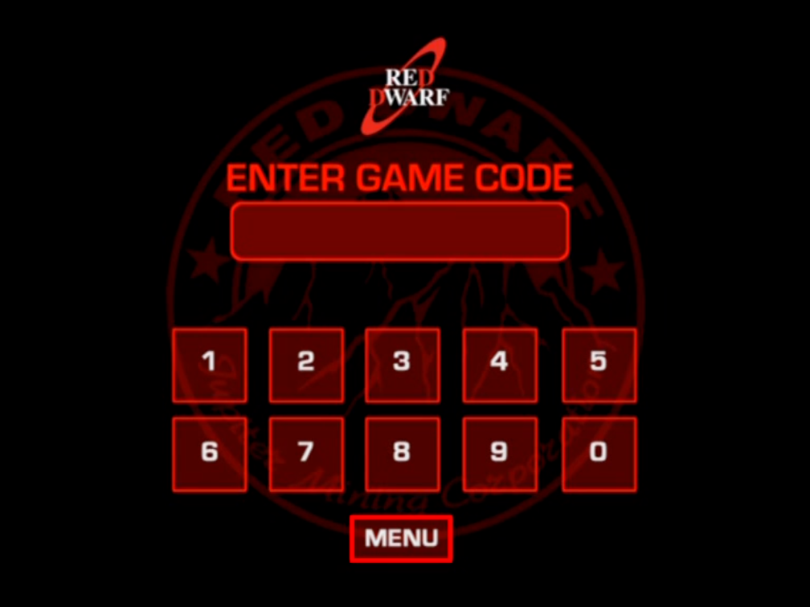

# Red Dwarf: Beat the Geek — Web Edition

[](https://github.com/abedegno/red-dwarf-beat-the-geek/actions/workflows/ci.yml)
[](LICENSE)

A faithful browser port of the interactive DVD quiz game. Original video, menus,
Holly presentations, question pools and timing drive a native React game—there is
no DVD player or virtual machine running in the browser.

**[Play online](https://red-dwarf-beat-the-geek.pages.dev/)** · [Build your own copy](docs/setup.md)



## What’s playable

- **Viewer, Geek and General Knowledge**, with all eight levels and final bonuses.
- **Norman and Hattie’s Holly** presentations and original branching responses.
- **One or two players**, with the authored mode choices and scoring.
- **How to Play**, including the original timed picture subtitles.
- **Games Archive**: maze, whack, vending, memory and lager games, including their
  original quirks and return paths.
- Mouse, touch and keyboard controls; responsive 4:3 presentation and fullscreen.

<table>
<tr><td></td><td></td></tr>
<tr><td>Original question artwork</td><td>Original Archive presentation</td></tr>
</table>

## Run the code

Node **22.23+** and Python **3.11+** are required. No DVD data is needed for these
contributor checks:

```sh
git clone https://github.com/abedegno/red-dwarf-beat-the-geek.git
cd red-dwarf-beat-the-geek
npm --prefix app ci
npm --prefix app test
python3 -m unittest discover -s tests/unit -v
BTG_BUNDLE_ONLY=1 npm --prefix app run build
```

The code-only build shows a load error until you provide owner
assets. The public repository contains no ISO, VOBs, game video or conversion
caches. Original-game captions and the selected documentation screenshots are
identified separately in [NOTICES.md](NOTICES.md).

## Build and host your own copy

Start with a complete backup of the supported **UK PAL 2EDVD108** disc. The importer
checks its exact fingerprint and source-file checksums; other editions are not yet
supported. It never writes to your backup.

Install the [native dependencies or container](docs/setup.md), then:

```sh
python3 tools/btg.py doctor
python3 tools/btg.py import '/path/to/disc/VIDEO_TS' --workspace owner-workspace
python3 tools/btg.py encode --workspace owner-workspace --profile web
python3 tools/btg.py build --workspace owner-workspace --profile web --output site
python3 tools/btg.py preview site
```

Open **http://127.0.0.1:4173/**. The first conversion takes substantial time and disk
space; interrupted encoding resumes from verified per-clip caches. Keep roughly
**20 GB free** for source, working assets and a deployment package; source-model
reconstruction can take tens of minutes before visible media output appears.
See [encoding profiles and overrides](docs/encoding.md).

The result is a static website: HTML, JavaScript, JSON, MP4 and PNG. It needs no
backend, database or runtime DVD libraries. Serve it at a domain root with HTTPS,
correct MIME types and HTTP byte ranges. [Deploy it to Cloudflare Pages](docs/deployment.md)
using your own account, or use another compatible static host.

## Controls

Click or tap the original artwork regions. Use Tab to focus controls, arrow keys
to move between choices, and Enter or Space to activate. Controls become active at
the original authored times. Restart returns to the start screen; Full screen uses
the browser’s fullscreen support.

## How it works

The offline tools inspect the DVD’s program chains, control rectangles and VM
commands, then recover explicit game data and clip references. The browser runs
ordinary TypeScript state machines. Media comes from source cells; the web build
keeps the original 768×576, 25 fps presentation and timing.

Packaging hashes and deduplicates referenced media, rewrites URLs in deployment
copies and checks every file before replacing the previous output. Canonical owner
datasets remain unchanged. [Architecture](docs/architecture.md) explains the boundary.

## Documentation

[Owner setup](docs/setup.md) · [Encoding](docs/encoding.md) ·
[Hosting](docs/deployment.md) · [Testing](docs/testing.md) ·
[Troubleshooting](docs/troubleshooting.md) · [Contributing](CONTRIBUTING.md)

This is an unofficial fan preservation project, not an official Red Dwarf release.
Software is **GPL-2.0-or-later**. Original game footage, artwork, audio and text
remain their respective owners’ material; the software license grants no rights
to redistribute those assets. See [NOTICES.md](NOTICES.md).
